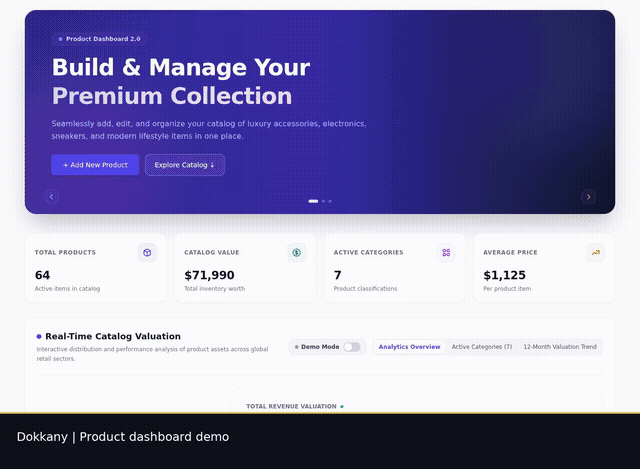

# Dokkany | Products & Analytics

[Open the live site](https://dokkany.vercel.app/)

A responsive e-commerce dashboard demo for exploring a product catalog, category analytics and user-management interfaces. It is a frontend showcase, not a connected store administration service.

## Live walkthrough



[Watch or download the MP4 recording](docs/demo/walkthrough.mp4). Two-voice Egyptian-Arabic narrated walkthrough, recorded from the live site on November 15, 2026; the interface may change as development continues.

## Features

- Product cards with search, category/stock filters, sorting and pagination.
- Product forms and catalog management interactions.
- KPI cards, category value distribution and revenue-style charts.
- User-management screens, themes and English/Arabic interface support.
- Demo data and simulated analytics. Names, counts and charts in the demo must not be treated as real customer or financial records.

## Stack

React, TypeScript, Vite, Tailwind CSS, React Router, Recharts, TanStack Table, Headless UI and i18next. See `package.json` for the installed versions.

## Run locally

```bash
npm install
npm run dev        # use the local URL printed by Vite
npm run lint
npm run build      # type-check + production output in dist/
npm run preview
```

Use a current Node.js LTS release supported by the installed Vite version. The default dashboard can be explored with the bundled data; do not enter real customer information into the demo.

## Repository map

- `src/components/`: catalog, analytics, navigation and shared UI.
- `src/data/`: sample products and users.
- `src/context/`: theme and optional AI state.
- `src/i18n/`: translations and language settings.
- `src/server/`: development-side integration code.

## Deployment and integration boundaries

Build with `npm run build` and serve `dist/` using SPA route fallback. A real store needs its own authenticated API, authorization and durable database. Keep private provider keys on a server; client code and `VITE_*` variables are visible to visitors.
